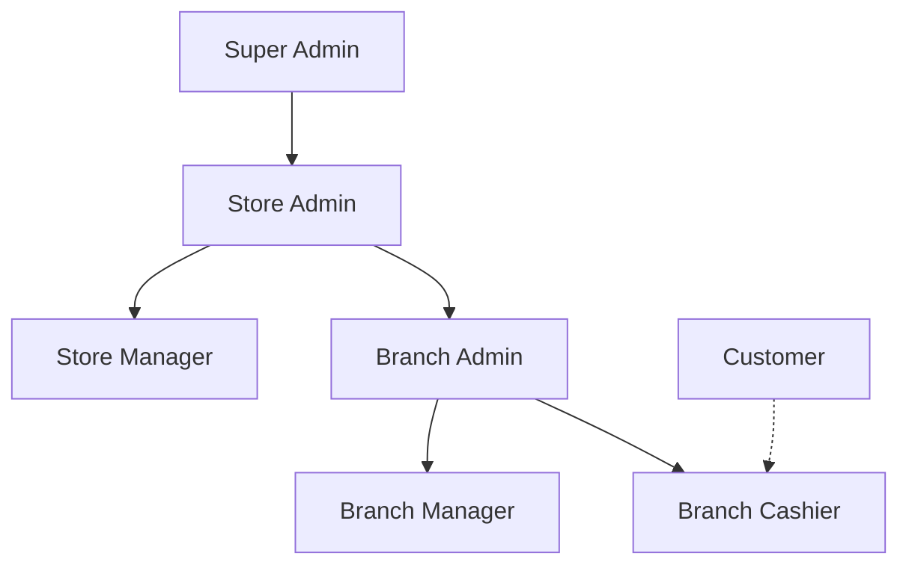

# E-Commerce POS System - Project Overview

## 🎯 System Architecture

This is a **full-stack E-Commerce Point of Sale (POS) system** built with:
- **Backend**: Spring Boot (Java) with MySQL database
- **Frontend**: React.js
- **Authentication**: JWT-based with role-based access control (RBAC)
- **Payment Integration**: Razorpay & Stripe
- **Email Service**: Gmail SMTP

---

## 🏢 Business Model

The system follows a **hierarchical multi-tenant architecture**:



### Hierarchy Levels:
1. **Super Admin** - Platform owner (manages all stores)
2. **Store Level** - Individual business owners with multiple branches
3. **Branch Level** - Physical locations with employees
4. **Customer** - End users making purchases

---

## 👥 User Roles & Permissions

### 1. **ROLE_STORE_ADMIN** (Store Owner)

#### ✅ **CAN DO:**
- Create and manage their own store
- Create Store Managers
- Create and manage all branches under their store
- Create Branch Managers, Branch Admins, and Branch Cashiers
- View all employees across all branches
- Manage products and categories for the entire store
- View analytics for all branches
- Delete orders (with Store Manager)
- Manage inventory across all branches
- Update/delete store information

#### ❌ **CANNOT DO:**
- Access other stores' data
- Create other Store Admins
- Moderate store approval status (Super Admin only)
- Create orders (cashier-only function)

---

### 2. **ROLE_STORE_MANAGER** (Store Operations Manager)

#### ✅ **CAN DO:**
- Create Store-level employees (Store Managers, Branch staff)
- View all employees in the store
- Manage products and categories
- Manage inventory
- View store-wide analytics
- Delete orders
- View all branches

#### ❌ **CANNOT DO:**
- Create or delete the store itself
- Delete employees (only Store/Branch Admin can)
- Create orders directly
- Approve/decline store requests
- Access branch-specific employee creation (Branch Admin handles this)

---

### 3. **ROLE_BRANCH_ADMIN** (Branch Owner/Administrator)

#### ✅ **CAN DO:**
- Create Branch Managers and Branch Cashiers for their branch
- Update employees in their branch
- Delete employees in their branch
- View all employees in their branch
- View branch-specific analytics
- View recent orders for their branch
- Manage branch information

#### ❌ **CANNOT DO:**
- Create or manage products/categories (Store-level only)
- Create stores or other branches
- View other branches' data
- Delete orders
- Manage inventory (Store Manager only)
- Create store-level employees

---

### 4. **ROLE_BRANCH_MANAGER** (Branch Operations Manager)

#### ✅ **CAN DO:**
- Create Branch Cashiers and other Branch Managers
- Update employees in their branch
- View all employees in their branch
- View branch analytics (sales, revenue, top products)
- View recent orders
- Generate shift reports

#### ❌ **CANNOT DO:**
- Delete employees (Branch Admin only)
- Create or manage products
- Delete orders
- Manage inventory
- Create branches
- View other branches' data

---

### 5. **ROLE_BRANCH_CASHIER** (Point of Sale Operator)

#### ✅ **CAN DO:**
- **Create orders** (PRIMARY FUNCTION)
- Process payments (Cash, Card, UPI, Razorpay, Stripe)
- View their own orders
- View customer information
- Search products
- View branch inventory

#### ❌ **CANNOT DO:**
- Create, update, or delete products
- Manage employees
- View analytics or reports
- Delete orders
- Manage inventory levels
- Create customers (auto-created during checkout)
- Access other branches

---

### 6. **ROLE_CUSTOMER** (End User)

#### ✅ **CAN DO:**
- View their own order history
- Make purchases through cashier
- Receive receipts

#### ❌ **CANNOT DO:**
- Access admin panels
- Create orders directly (must go through cashier)
- View other customers' data
- Manage products or inventory

---

## 🔐 Special Features

### **Master Password System**
- Fallback authentication mechanism
- Each role has a master password stored in the database
- Users can log in with their email + master password for their role
- Tracks usage count and last used timestamp
- Can be enabled/disabled per role
- **Use Case**: When employees forget their password but need immediate access

**Authentication Flow:**
1. Try normal password first
2. If fails, check master password for user's role
3. If master password valid, grant access with user's actual role and context

---

## 📊 Key Modules

### **1. Store Management**
- Create/update/delete stores
- Store approval workflow (Super Admin moderates)
- Store status: `PENDING`, `APPROVED`, `DECLINED`

### **2. Branch Management**
- Multi-branch support per store
- Branch-specific inventory
- Branch analytics

### **3. Employee Management**
- Hierarchical employee creation
- Role-based access control
- Employee assignment to stores/branches

### **4. Product & Category Management**
- Store-level product catalog
- Category organization
- Product search functionality

### **5. Inventory Management**
- Track stock levels
- Store Manager controls inventory

### **6. Order Management**
- Cashier creates orders
- Payment processing (multiple gateways)
- Order history and tracking
- Refund support

### **7. Analytics & Reporting**
- Branch-level analytics (sales, revenue, top products)
- Store-level analytics
- Shift reports for cashiers
- Recent orders dashboard

### **8. Payment Processing**
- Cash, Card, UPI
- Razorpay integration
- Stripe integration
- Payment summaries

### **9. Customer Management**
- Auto-created during checkout
- Order history tracking

### **10. Subscription Management**
- Subscription plans for stores
- Subscription tracking

---

## 🔄 Typical Workflows

### **Store Onboarding:**
1. User signs up as Store Admin
2. Creates store (status: PENDING)
3. Super Admin approves store
4. Store Admin creates branches
5. Store Admin creates products/categories
6. Store Admin creates employees

### **Daily Operations:**
1. Branch Cashier logs in
2. Customer comes to checkout
3. Cashier searches products
4. Creates order with items
5. Processes payment
6. Customer receives receipt

### **Employee Management:**
- **Store Admin** creates Store Managers
- **Store Admin/Manager** creates Branch Admins
- **Branch Admin** creates Branch Managers and Cashiers

---

## 🛡️ Security Features

- **JWT Authentication**: Secure token-based auth
- **Role-Based Access Control**: `@PreAuthorize` annotations on endpoints
- **Password Encryption**: BCrypt encoding
- **Master Password**: Fallback authentication with usage tracking
- **Password Reset**: Email-based token system (5-minute expiry)
- **CORS Configuration**: Frontend-backend communication

---

## 📁 Project Structure

### **Backend:**
```
ecommerce-backend/
├── controller/     # REST API endpoints
├── service/        # Business logic
├── repository/     # Database access
├── modal/          # Entity models
├── payload/        # DTOs and responses
├── configrations/  # Security, JWT config
└── exception/      # Custom exceptions
```

### **Frontend:**
```
ecommerce-frontend/
├── pages/
│   ├── auth/           # Login, signup, password reset
│   ├── store/          # Store admin dashboard
│   ├── cashier/        # POS interface
│   ├── Branch Manager/ # Branch management
│   └── SuperAdminDashboard/ # Platform admin
├── components/     # Reusable UI components
└── utils/          # Helper functions, role configs
```

---

## 🎨 Frontend Pages by Role

| Role | Pages/Features |
|------|----------------|
| **Store Admin** | Store dashboard, branch management, employee management, product catalog, analytics |
| **Store Manager** | Similar to Store Admin but cannot delete store |
| **Branch Admin** | Branch dashboard, branch employee management, branch analytics |
| **Branch Manager** | Branch operations, shift reports, order monitoring |
| **Cashier** | POS interface, product search, order creation, payment processing |
| **Customer** | Order history, receipts |

---

## 🔧 Configuration

### **Database:**
- MySQL on `localhost:3306`
- Database: `e_commerce`
- Auto-creates tables via Hibernate DDL

### **Email:**
- Gmail SMTP (port 587)
- Used for password reset emails

### **Payment Gateways:**
- Razorpay API key required
- Stripe API key required

### **Server:**
- Backend runs on port `5000`
- Frontend runs on port `5173`

---

## 📝 Summary

This is a **production-ready, multi-tenant POS system** designed for businesses with multiple branches. It provides:

✅ **Hierarchical role management** with strict access controls  
✅ **Complete POS functionality** for in-store sales  
✅ **Multi-branch support** with centralized management  
✅ **Analytics and reporting** for business insights  
✅ **Flexible payment processing** with multiple gateways  
✅ **Master password fallback** for emergency access  
✅ **Secure authentication** with JWT and RBAC  

The system is ideal for retail chains, restaurants, or any business requiring centralized management of multiple physical locations with different employee roles and responsibilities.
